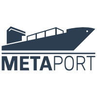
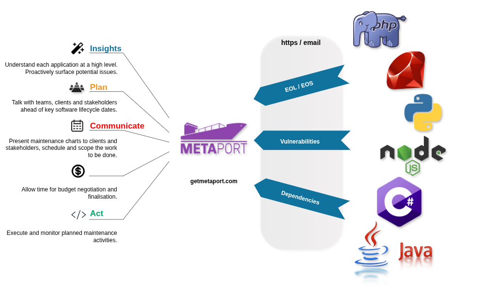

  <picture>
    <source media="(prefers-color-scheme: dark)" srcset="./metaport-logo-readme.png" />
    
  </picture>

# Metaport CE

In the digital delivery space, teams are tasked with the **reliability**, **security**, and **maintenance** of key components of **other people’s businesses**.

But effective digital teams are defined by data-driven insights, which require timely and digestible data about teams' entire portfolios:

* End-of-life and end-of-support dates
* Apps affected by vulnerabilities
* Sites with legacy dependencies

But do your teams really have ready access to this data, or is it still siloed within engineering roles?

The effort required to plan software upgrades and patching across portfolios, are two of the common processes where teams appear content with the status quo. But the status quo won't help account for the true cost of **reactive**, often **impromptu**, and likely **manual** maintenance practices.

Data-driven decision-making from direct visibility into developer and AI agent output, and keeping abreast of the rapid change they engender, are critical for business continuity. Businesses without it, or that find it expensive or time-prohibitive to obtain, are stymied from realising their potential.

Metaport is technology agnostic which means your PHP, Node, Python, or .Net apps can all use it. See more at: [getmetaport.com](https://getmetaport.com/) and checkout the docs at [https://docs.metaport.sh](https://docs.metaport.sh).

If you're a Team Lead or Project Manager, your insights are **absolutely vital** in helping to provide direction to the project in terms of features, integrations and priority bugfixes. 2m of your time is all it takes in our [ongoing survey](https://us11.list-manage.com/survey?u=50f1fdd65147cfedfbaa69727&id=994b835794).

  
&nbsp;

  
  
&nbsp;

## Features

* **Proactive Planning:** Share component lifeycle gantt charts with clients and stakeholders. Import schedules into shared calendars.
* **Portfolio Insights:** Quickly surface components, dependencies and vulnerabilities across **entire application portfolios**. 1
* **Birds Eye View:** At-a-glance views into the current maintenance standing of your team's apps.
* **Stay Informed:** Crafting custom policies and notifications, keeps teams on top of application maintenance of an ever-changing app portfolio.
* **Technology Agnostic:** Metaport works with your PHP, Node, Python, or .Net apps, and it doesn't care about your VCS.
* **Role Based Access:** Role-Based Access Control (RBAC) applies distinct roles to your team, so they access only what they should, nothing more.
* **Single Sign-on:** Metaport integrates with [KeyCloak](https://keycloak.org/) to provide comprehensive SSO for your organisation.
* **Open Source:** With Metaport's [open source codebase](https://gitlab.com/dcentrica/metaport/metaport-server), common interfaces, and great docs, it's easy to build new features.

 1. Basic dependency and security vulnerability is out of the box in "Classic" mode. For more thorough reporting, Metaport integrates with [DependencyTrack](https://dependencytrack.org).

## End User Documentation

Go to our dedicated documentation site at [docs.metaport.sh](docs.metaport.sh).

## Issues

Metaport CE is open source software! Use our [issue tracker](https://gitlab.com/dcentrica/metaport/metaport-server/-/issues) and be sure to read our [software license](./LICENSE.txt) and [contributing guidelines](./CONTRIBUTING.md).

## Thanks

Credit to the maintainers of the [goldfinch/enchantment](https://github.com/goldfinch/enchantment) package ([MIT](https://github.com/goldfinch/enchantment/blob/main/LICENSE.md)) which Metaport makes use of for its administration theme.

Credit goes to [Catalyst IT](https://catalyst.net.nz/) for the original investment and development of [Mataara](https://gitlab.com/Mataara) (formerly Archimedes) which heavily influenced the development of Metaport.
